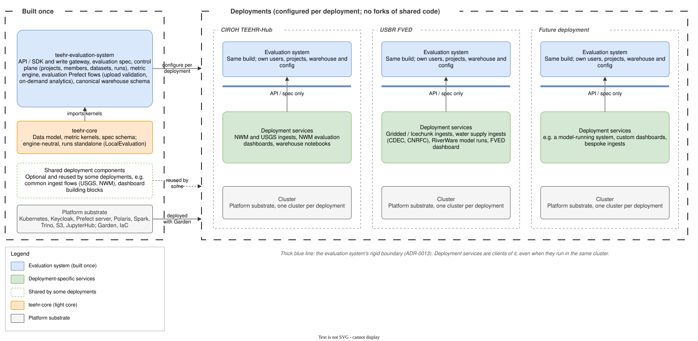
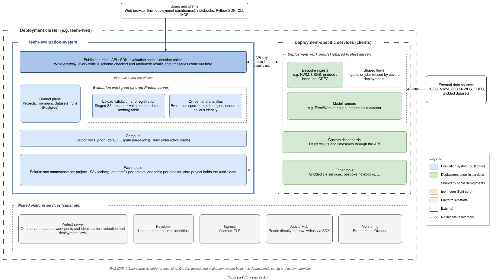

# Design diagrams

Diagrams for the project-based platform redesign ([#133](https://github.com/RTIInternational/teehr-cloud-core/issues/133)). `evaluation-system.drawio` has one page per diagram, and `svg/` has an export of each page for viewing on GitHub.

1. **Evaluation system in deployments.** The evaluation system is built once and configured per deployment (ADR-0008). Each deployment adds its own services, some shared with other deployments. These services are clients of the evaluation system and reach it only through the API and spec (ADR-0013).
2. **Evaluation-system boundary.** A zoom into one deployment. The API, SDK and spec are the only public surface, and the rest of the evaluation system is private. Evaluation flows (upload validation, on-demand analytics) and deployment flows (bespoke ingests, model runners) use separate work pools on a shared Prefect server.





## Exporting SVGs

Re-export after editing the `.drawio` file:

```bash
cd teehr-cloud-core/docs/design/diagrams
rm -rf svg
docker run --rm -u "$(id -u):$(id -g)" -e HOME=/tmp -v "$PWD":/data -w /data \
  rlespinasse/drawio-export:v4.60.0 \
  -f svg -o svg -b 10 --svg-theme light --embed-svg-fonts false evaluation-system.drawio
```
