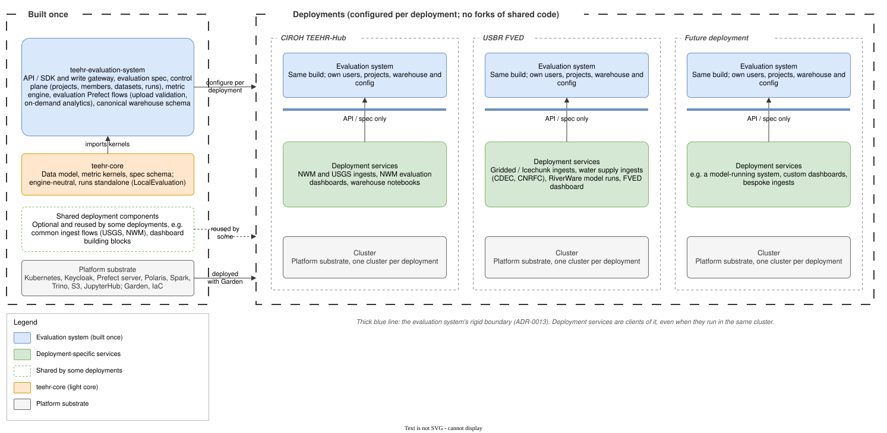
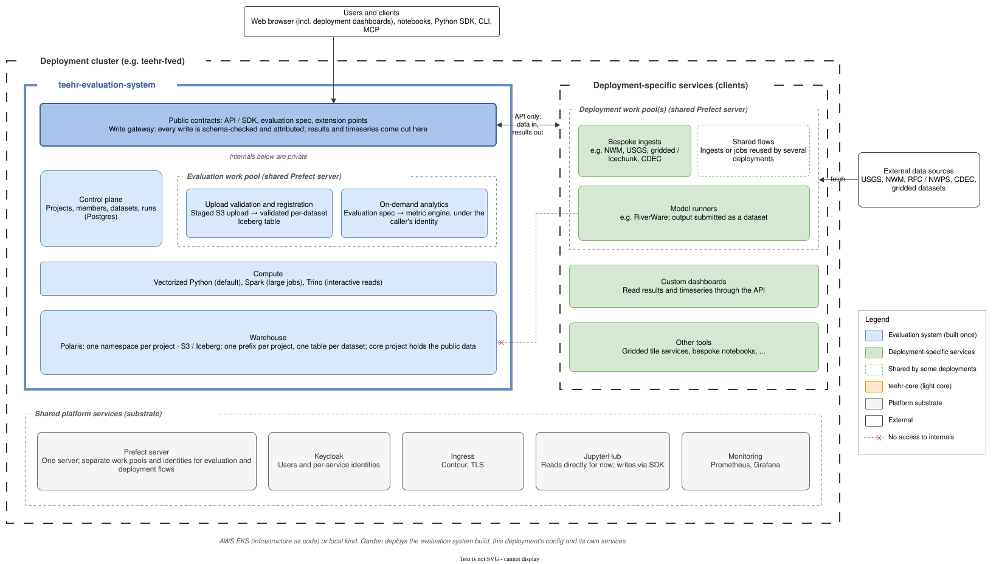

# System layout — conceptual architecture (DRAFT, for iteration)

> **Status:** DRAFT — not yet ratified. Narrative companion to the diagrams in
> [`diagrams/`](diagrams/) (drawio source + SVG), which are the **canonical pictures**.
> This doc carries the prose the diagrams don't: the repo/package mapping, where fetch/load
> falls, and the bulk-ingest pattern.
> **Date:** 2026-11-13

The organizing idea (ADR-0011 + ADR-0013): the **evaluation system** is a service a
deployment *stands up and leverages* — exactly like it leverages Prefect — through a
contract, never by forking or reaching inside. Roughly what VeriRace provides is that
contract surface (spec, API, CLI, MCP). Everything else a deployment needs — custom UIs,
model runners, bespoke ingests — is a **deployment-specific service** that is a *client* of
the evaluation system.

## 1. The evaluation system across deployments

Built once, configured per deployment (ADR-0008) — **no forks of shared code**. Each
deployment (CIROH TEEHR-Hub, USBR FVED, …) adds its own services — some shared by several
deployments — and they reach the evaluation system only through the **API / spec**.



Why "a service you leverage": the same relationship repeats at two levels — a deployment
leverages the evaluation system; the evaluation system in turn leverages the **platform
substrate** (Prefect to run jobs, Polaris/Trino/Spark for data, Keycloak for auth). Like
Prefect, it is self-hostable per deployment (what we do) and *could* conceptually be one
shared instance; even per-deployment, the **project boundary** gives the multi-tenant slice
we need for now.

## 2. The evaluation-system boundary

A zoom into one deployment. The **API, SDK and spec are the only public surface**; the rest
is private (warehouse, Polaris, Spark jobs, control-plane DB, internal packages). Evaluation
flows (upload validation, on-demand analytics) and deployment flows (bespoke ingests, model
runners) run on **separate Prefect work pools** on a shared Prefect server. A model runner
submits its output as a dataset *through the API*, like any other producer.



## 3. Repo / package organization

Where each layer's code lives — ADR-0007 decides *what* is packaged, ADR-0008 *where*. New
repos only where an independent lifecycle or parallel-run vs legacy demands it; everything
else is shared, not duplicated; no deployment-specific fork.

| Layer | Repo / package | Notes |
| --- | --- | --- |
| **Evaluation service** | Service layer — **NEW repo** | REST API · CLI · MCP · spec engine · write gateway · canonical-schema owner (interface ≈ VeriRace contracts, ADR-0011) |
| **Engine-free core** | `teehr-core` — **NEW light package** | metric kernels + data model + spec schema + state format; numpy/pandas, Spark optional; the engine-neutral library TEEHR publishes for others (e.g. VeriRace) to adopt (ADR-0011) |
| **Fetch / load** | `teehr[fetch]` — optional extra | Spark-decoupled; common sources shipped; deployments add their own |
| **Platform substrate** | `teehr-cloud-core` (+ `teehr-cloud-platform` IaC, `teehr-iceberg-authmanager`) | Polaris · Keycloak · Trino · Spark · Prefect · JupyterHub · Garden — kept and shared |
| **Deployment** | `teehr-hub` / `teehr-fved` | config + deployment-specific services (UIs, model runners, bespoke ingests, certs) |

## Where data fetch/load falls

Fetch/load is a **data-producer pattern — like a model runner — not an internal of the
evaluation system.** It splits cleanly, and the split maps onto the two work pools above:

| Aspect | Home | Runs on |
| --- | --- | --- |
| The fetch/load *library* | **Core** — `teehr[fetch]` (ADR-0007) | — |
| Common sources (USGS, NWM, NWPS) | **Core** — shipped; an evaluation flow | **Evaluation** work pool |
| Bespoke sources (e.g. FVED RiverWare) | **Deployment** — ancillary | **Deployment** work pool |
| Scheduling / orchestration | Deployment policy (Prefect) | respective pool |

Either way the bytes **register through the write gateway** — validated and attributed like
any write. Fetch is not privileged internal access.

### Bulk data in: staged upload (confirmed pattern, from VeriRace)

Large data does **not** stream through the API — that would make the boundary a bottleneck.
The API is a control plane and the bytes go straight to object storage:

```
POST /uploads          → API returns a short-lived, scoped upload URL
PUT  <upload_url>       → file goes DIRECTLY to object storage (bypasses the API)
POST /uploads/{id}/inspect   → reads first rows, proposes a column→series mapping
POST /uploads/{id}/ingest    → runs the load as a JOB; whole file validated before any write
GET  /uploads/{id}           → status (queued → running → succeeded/failed)
```

The staged file is deleted after load. **Both model runners and fetchers submit bulk data
this way** — the boundary holds (API authorizes, validates, registers, and runs the ingest
job) while GB-scale bytes never pass through it.

On TEEHR's substrate the pieces already exist: the upload URL is an **STS-vended,
prefix-scoped credential** (Spike 2 / `allowed_locations`, ADR-0001); the staged area is a
**project-scoped S3 prefix**; the ingest job is a **Prefect job** (ADR-0003) on the
appropriate work pool, writing to Iceberg through the write gateway.

## Open questions

- Does "service layer" stay one repo, or split API vs spec-engine vs write-gateway?
- Are **common-source fetchers** operated by the platform (core-run, evaluation work pool)
  or deployment-triggered? (Mechanically producers either way.)
- **Submodule vs deployed-service:** today `teehr-cloud-core` is a submodule *inside* each
  deployment repo; the "service you leverage" model leans toward *deployed once and
  consumed*. ADR-0008 already allows this ("the repo/submodule mechanics may change") —
  worth deciding explicitly.
